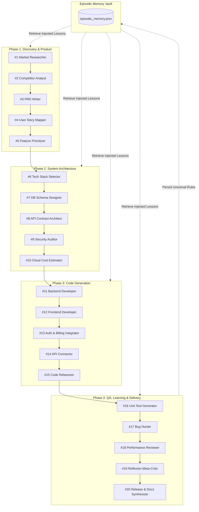
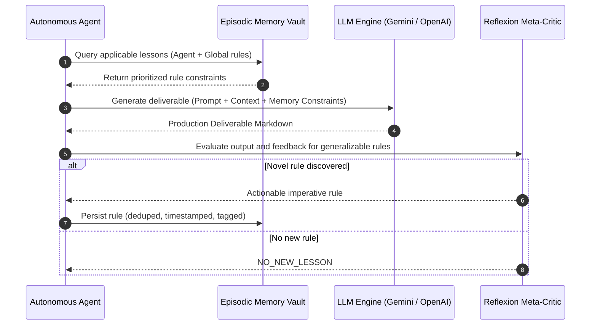

# AutoDev Studio — 20-Agent Self-Learning AI Agency

[](https://www.python.org/downloads/)
[](https://fastapi.tiangolo.com)
[](https://opensource.org/licenses/MIT)
[](https://github.com)
[](https://github.com)

> **AutoDev Studio** is an autonomous, full-lifecycle software engineering agency powered by 20 specialized AI agents. Operating across 4 sequential engineering phases, AutoDev Studio designs, architects, codes, tests, and documents production-ready SaaS platforms from a single prompt—continuously improving via an **Episodic Reflexion Memory Loop**.

---

## Table of Contents
- [Executive Overview & Value Proposition](#executive-overview--value-proposition)
- [System Architecture](#system-architecture)
  - [4-Phase 20-Agent Pipeline Matrix](#4-phase-20-agent-pipeline-matrix)
  - [Episodic Reflexion Memory Loop](#episodic-reflexion-memory-loop)
- [Tech Stack Breakdown](#tech-stack-breakdown)
- [Directory Structure](#directory-structure)
- [API Reference](#api-reference)
- [Installation & Quickstart](#installation--quickstart)
  - [1. Prerequisites](#1-prerequisites)
  - [2. Environment Setup](#2-environment-setup)
  - [3. Install Dependencies](#3-install-dependencies)
  - [4. Configure Environment Variables](#4-configure-environment-variables)
  - [5. Launch Application](#5-launch-application)
- [How Self-Learning Works](#how-self-learning-works)
- [License](#license)

---

## Executive Overview & Value Proposition

Traditional AI coding assistants function in single-shot isolation, lacking organizational memory and multi-role architectural decomposition. When building real-world SaaS products, engineering teams require market validation, competitive analysis, normalized schemas, API contracts, security audits, clean modular code, unit tests, and post-mortem learnings.

**AutoDev Studio** simulates an entire high-velocity software engineering firm:
- **Autonomous Multi-Role Swarm**: 20 distinct agent personas sequentially execute domain deliverables—from market validation to production release synthesis.
- **Continuous Episodic Reflexion**: Unlike stateless LLM pipelines, each agent reflects on its execution and user feedback. Actionable engineering rules are crystallized and stored into an episodic memory vault, preventing repeated mistakes in subsequent runs.
- **Real-Time Reactive Streaming**: Built on FastAPI and Server-Sent Events (SSE), streaming execution updates, phase transitions, and markdown artifacts directly to a glassmorphic dashboard.
- **Provider Agnostic**: Seamlessly switches between Google Gemini (`gemini-2.5-flash`, `gemini-1.5-pro`) and OpenAI (`gpt-4o`, `gpt-4o-mini`).

---

## System Architecture

### 4-Phase 20-Agent Pipeline Matrix



### Complete Agent Roster

| # | Agent Name | Phase | Primary Mission & Deliverables |
|---|---|---|---|
| **01** | **Market Researcher** | Discovery & Product | Analyzes ICP, urgent pain points, TAM/SAM/SOM, and value propositions. |
| **02** | **Competitor Analyst** | Discovery & Product | Evaluates competitor parity, pricing models, and strategic moats. |
| **03** | **PRD Writer** | Discovery & Product | Authors authoritative PRD, success OKRs, and non-functional requirements. |
| **04** | **User Story Mapper** | Discovery & Product | Translates specs into agile user stories with Given/When/Then acceptance criteria. |
| **05** | **Feature Prioritizer** | Discovery & Product | Applies RICE scoring and MoSCoW prioritization to scope the strict MVP. |
| **06** | **Tech Stack Selector** | System Architecture | Determines battle-tested languages, DB engines, caching layers, and cloud infrastructure. |
| **07** | **DB Schema Designer** | System Architecture | Generates 3NF normalized relational schemas, foreign keys, and indexes. |
| **08** | **API Contract Architect** | System Architecture | Specifies OpenAPI-compliant REST contracts, JSON schemas, and error envelopes. |
| **09** | **Security Auditor** | System Architecture | Audits against OWASP Top 10, JWT lifecycles, RBAC permissions, and encryption. |
| **10** | **Cloud Cost Estimator** | System Architecture | Models cloud unit economics and hosting tiers from launch to 10,000 active users. |
| **11** | **Backend Developer** | Code Generation | Implements modular FastAPI/Express router handlers, models, and business logic. |
| **12** | **Frontend Developer** | Code Generation | Crafts modern, responsive client components, view layouts, and state management. |
| **13** | **Auth & Billing Integrator** | Code Generation | Integrates authentication middleware, token guards, and Stripe webhook billing. |
| **14** | **API Connector** | Code Generation | Implements external SDK wrappers, retry with exponential backoff, and async queues. |
| **15** | **Code Refactorer** | Code Generation | Eliminates code smells, enforces Clean Architecture, and guarantees DRY principles. |
| **16** | **Unit Test Generator** | QA & Delivery | Delivers comprehensive Pytest fixtures, happy/unhappy path tests, and mock stubs. |
| **17** | **Bug Hunter** | QA & Delivery | Performs static analysis to patch race conditions, null references, and unhandled traps. |
| **18** | **Performance Reviewer** | QA & Delivery | Evaluates query plans, N+1 hazards, Redis cache TTLs, and p95 latency targets. |
| **19** | **Reflexion Meta-Critic** | QA & Delivery | Conducts end-to-end post-mortem and crystallizes global, cross-project engineering rules. |
| **20** | **Release & Docs Synthesizer**| QA & Delivery | Compiles the executive dossier, production README.md, and deployment checklist. |

---

### Episodic Reflexion Memory Loop

Each agent executes through an autonomous 3-step loop: **Retrieve $\rightarrow$ Execute $\rightarrow$ Critique $\rightarrow$ Store**.

```
       +-------------------------------------------------------------+
       |                  1. RETRIEVE MEMORY                         |
       |  Query episodic memory for agent-specific & global lessons  |
       |  Order by frequency of use and recency                      |
       +------------------------------+------------------------------+
                                      |
                                      v
       +-------------------------------------------------------------+
       |                  2. EXECUTE TASK                            |
       |  Inject: Past Rules + User Prompt + Upstream Agent Context  |
       |  LLM generates domain-specific Markdown deliverable         |
       +------------------------------+------------------------------+
                                      |
                                      v
       +-------------------------------------------------------------+
       |                  3. SELF-REFLECT & CRITIQUE                 |
       |  Objective AI Meta-Critic analyzes output + user feedback   |
       |  Extracts generalizable rule (or returns NO_NEW_LESSON)     |
       +------------------------------+------------------------------+
                                      |
                                      v
       +-------------------------------------------------------------+
       |                  4. STORE LESSON                            |
       |  Atomic write to episodic_memory.json                       |
       |  Deduplicate, increment usage counters, and tag category   |
       +-------------------------------------------------------------+
```



---

## Tech Stack Breakdown

- **Core Engine & Backend**:
  - **Python 3.10+**: Type-hinted modular architecture with asynchronous support.
  - **FastAPI**: High-performance ASGI framework with Pydantic v2 data validation and OpenAPI 3.0 documentation.
  - **Server-Sent Events (SSE)**: Native HTTP streaming (`text/event-stream`) providing live progress feeds without WebSocket overhead.
  - **Uvicorn**: Lightning-fast ASGI server implementation.
- **LLM Client Orchestration**:
  - **Google Gemini API**: Native integration via `google-genai` SDK (`gemini-2.5-flash`, `gemini-1.5-pro`).
  - **OpenAI API**: Integration via `openai` client (`gpt-4o`, `gpt-4o-mini`).
- **Episodic Memory Engine**:
  - **JSON Document Store**: Zero-dependency, file-backed atomic memory persistence with temp-swap safety.
  - **Deduplication & Scoring**: Case-insensitive text normalization, category indexing, and usage frequency tracking.
- **Frontend Dashboard**:
  - **Vanilla JavaScript (ES6+)**: Zero build tools required; reactive state management and native `EventSource` consumption.
  - **Tailwind CSS CDN**: Dark-mode SaaS layout, glassmorphic surfaces, glow effects, and custom scrollbars.
  - **Marked.js CDN**: Live client-side rendering of agent deliverables, Markdown tables, and syntax blocks.

---

## Directory Structure

```text
autodev-studio/
├── backend/
│   ├── agents/
│   │   ├── __init__.py            # Registry & orchestrator exports
│   │   ├── agent_registry.py      # Detailed specifications for all 20 agents
│   │   └── orchestrator.py        # Sequential pipeline executor & context windowing
│   ├── api/
│   │   ├── __init__.py
│   │   └── routes.py              # FastAPI endpoints (/agents, /memory, /run/stream)
│   ├── core/
│   │   ├── __init__.py
│   │   ├── base_agent.py          # SelfLearningAgent with 3-step execution loop
│   │   └── llm_client.py          # Unified Gemini & OpenAI client wrapper
│   ├── memory/
│   │   ├── __init__.py
│   │   ├── memory_manager.py      # Episodic memory storage, retrieval, & deduplication
│   │   └── episodic_memory.json   # Persistent memory store (lessons & run logs)
│   └── main.py                    # FastAPI entrypoint and static file mount
├── frontend/
│   └── index.html                 # Dark-mode dashboard, agent matrix & memory vault
├── .env                           # Environment keys and provider configuration
├── requirements.txt               # Locked Python dependencies
└── README.md                      # Authoritative project documentation
```

---

## API Reference

### 1. `GET /api/agents`
Returns metadata, IDs, phases, and descriptions for all 20 autonomous agents.

### 2. `GET /api/memory`
Returns aggregate memory statistics, stored lessons, and historical run logs.
```json
{
  "stats": {
    "total_runs": 3,
    "total_learned_rules": 8,
    "lessons_per_agent": {
      "Security Auditor": 2,
      "global": 3
    }
  },
  "lessons": [
    {
      "id": "c1f7b8e9-2184-4a4b-9723-95cfcbdf1204",
      "agent_name": "Security Auditor",
      "lesson": "Always set HttpOnly, Secure, and SameSite=Lax flags on JWT authentication cookies.",
      "category": "security",
      "timestamp": "2026-11-21T12:00:00Z",
      "usage_count": 4
    }
  ],
  "runs": [...]
}
```

### 3. `POST /api/memory/feedback`
Manually inject or reinforce an operational rule into an agent or globally.
```json
{
  "agent_name": "DB Schema Designer",
  "lesson": "Always index foreign key columns and add updated_at trigger audit timestamps.",
  "category": "architecture"
}
```

### 4. `GET /api/run/stream`
Executes the 20-agent pipeline sequentially, yielding Server-Sent Events (SSE).
- **Query Parameters**:
  - `project_idea` *(string, required)*: The core SaaS product concept.
  - `user_feedback` *(string, optional)*: Steering guidance, tech stack constraints, or refinements.
- **Event Types**:
  - `pipeline_start`: Swarm initialization event.
  - `phase_start`: Transitioning into one of the 4 lifecycle phases.
  - `agent_start`: Signaled when a specific agent begins processing.
  - `agent_complete`: Yields deliverable Markdown, applied lessons, and newly learned rules.
  - `pipeline_complete`: Master summary with full run records and episodic statistics.

---

## Installation & Quickstart

### 1. Prerequisites
- **Python**: Version `3.10` or higher
- **API Key**: Either a Google Gemini API Key or an OpenAI API Key

### 2. Environment Setup

Clone the repository and create an isolated virtual environment:

```bash
# Clone the repository
git clone https://github.com/your-username/autodev-studio.git
cd autodev-studio

# Create Python virtual environment
python -m venv venv
```

Activate the virtual environment:
- **Windows (Command Prompt / PowerShell)**:
  ```powershell
  venv\Scripts\activate
  ```
- **macOS / Linux**:
  ```bash
  source venv/bin/activate
  ```

### 3. Install Dependencies

Install all pinned packages via `pip`:

```bash
pip install -r requirements.txt
```

### 4. Configure Environment Variables

Create or verify the `.env` file in the root directory:

```env
# Choose provider: "gemini" or "openai"
LLM_PROVIDER=gemini

# Google Gemini API Configuration
GEMINI_API_KEY=your_gemini_api_key_here

# OpenAI API Configuration (Optional if using Gemini)
OPENAI_API_KEY=your_openai_api_key_here
```

### 5. Launch Application

Start the FastAPI application using `uvicorn`:

```bash
uvicorn backend.main:app --reload --host 127.0.0.1 --port 8000
```

Open your browser and navigate to:
```text
http://127.0.0.1:8000
```

---

## How Self-Learning Works

1. **Context Window Optimization**: As agents execute in sequence, the orchestrator compiles a compact context window of previous deliverables, guaranteeing token efficiency while keeping foundational documents (PRD, Schema, Backend) intact.
2. **Episodic Reflexion**: After an agent produces its deliverable, an objective AI Meta-Critic reviews the output against any user feedback. If a generalizable principle is discovered, it is stored in `backend/memory/episodic_memory.json`.
3. **Agent 19 (Reflexion Meta-Critic)**: In Phase 4, Agent 19 performs a global retrospective across all preceding deliverables, extracting universal `[GLOBAL RULE]` constraints applied to all future projects.
4. **Interactive Teaching**: Developers can use the **Self-Learning Memory Vault** UI to inject domain rules (e.g. *"Enforce Stripe Webhook idempotency checking"*) that agents will immediately adhere to on future runs.

---

## License

This project is licensed under the [MIT License](LICENSE).
Feel free to customize, extend, and deploy your own autonomous software agency!